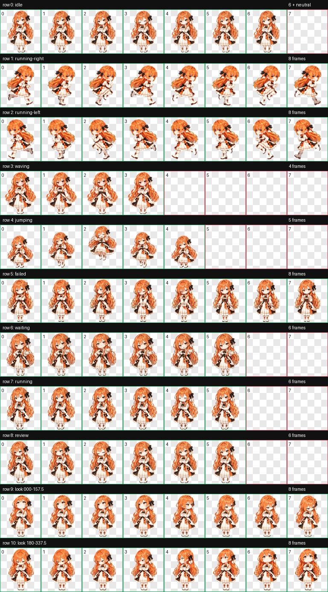

# Claude-Codex pet

一个橘发、花饰、黑白橙裙装的 Codex 桌面宠物。

**[下载宠物安装包](https://github.com/klu6163-droid/Claude-Codex-pet/releases/latest)**

## 动图预览

以下动图均来自 v1.1.0 高清版。

| 抱臂待机 | 傲娇挥手 | 开心小跳 |
| :---: | :---: | :---: |
|  |  |  |
| **向左小跑** | **向右小跑** | **鼓嘴不服气** |
|  |  |  |

## v1.1.0 高清重绘

整套角色与动作由 AI 重新高清绘制，保留橘发花饰、黑白橙裙装和傲娇人设。采用原生透明素材、完整轮廓提取和一次边缘颜色清理，修复旧版头发的青绿色残边。左跑继续逐帧镜像右跑。

Codex 安装图保持固定的 1536 × 2288 格式；另提供 [2 倍高清总图](art/spritesheet-master-2x.webp)（3072 × 4576），直接从高清原稿导出。预览页支持实际尺寸、2 倍高清和深色背景切换。

## v1.0.2 更新

左跑直接采用新版右跑的逐帧水平镜像，保留八帧顺序和播放节奏；其他十行动作保持不变。

## v1.0.1 更新

重绘向右跑的八帧步态，让双脚有更清楚的收回、抬起和向前迈出的交替变化。保留傲娇侧目，其余十行动作保持不变。

## 动作总图



包含抱臂待机、左右小跑、傲娇挥手、开心小跳、鼓嘴不服气、等待回应、认真思考、检查成果，以及 16 个注视方向。

## 安装

1. 从 Releases 下载 `Claude-Codex-pet-v1.1.0.zip` 并解压。
2. 将 `chengli-tsundere` 文件夹放入 `%USERPROFILE%\.codex\pets\`。
3. 在 Codex 的宠物列表中选择 **Claude-Codex pet**。如果列表没有刷新，重新打开 Codex。

安装后的目录结构：

```text
%USERPROFILE%\.codex\pets\chengli-tsundere\
├── pet.json
├── spritesheet.webp
├── README.md
└── 人设说明.md
```

内部 ID 保留为 `chengli-tsundere`。已有同 ID 宠物时，可先备份旧文件夹再替换。

## 交互预览

下载或克隆本仓库后，用浏览器打开 `preview/index.html`，可查看全部动作，并移动鼠标查看注视方向。该页面直接读取包内最终动画图。

## 格式

- Codex sprite version：`2`
- 动画图：透明 WebP，`1536 × 2288` 像素
- 布局：`8 × 11`，每格 `192 × 208` 像素
- 最终动画图 SHA-256：`3e03f7d98cf2ff25c06733b2fc15bb5c92db6bfe540d4049460f7ef537c32849`

角色外形参考由项目创建者提供，素材由 AI 图像工具生成，并经过动作筛选、边缘修复与排版验证。人设台词是创作说明；静态宠物包本身不会改变 Codex 助手人格，也不提供自动语音或对话。
